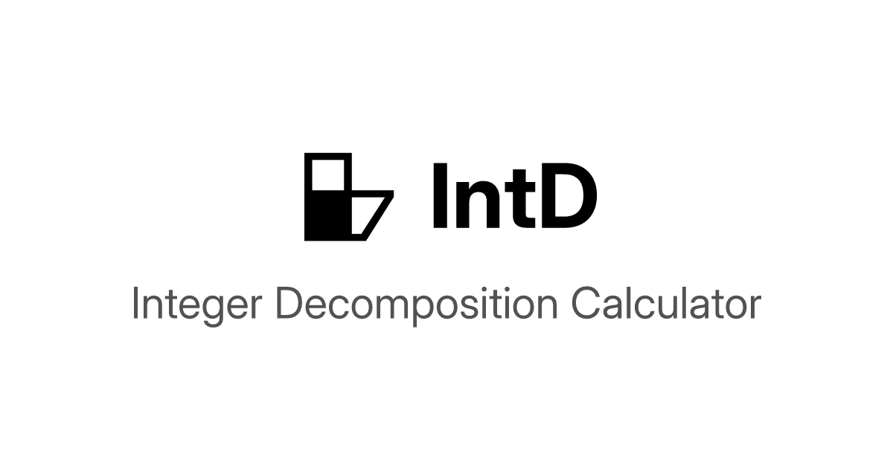

<div align="center">

# IntD: Integer decomposition calculator



An interactive demonstration of constrained integer decomposition. Choose a total and price rules to find matching item combinations.

Live at [https://intd.chingru.com](https://intd.chingru.com).


[](https://github.com/rutopio/ui)


</div>

## Repository structure

See [Repository structure](docs/repository-structure.md) for shared directory
roles, naming rules, asset placement, and the exceptions used by these sites.

```
src/
├── components/       # Page and layout components
├── content/          # Per-locale MDX content (zh_tw/, en/)
├── hooks/            # Custom hooks
├── lib/              # Calculation, validation, and formatting
├── locales/          # i18n strings (zh.json, en.json)
├── routes/           # File-based routes (TanStack Router)
├── styles/           # Global styles, fonts, and generated font CSS
└── types/            # Shared and ambient TypeScript declarations
```

## Language and routes

Chinese pages use `/`, `/algo`, and `/about`. English pages use the `/en` prefix.
`src/hooks/use-lang.ts` reads the language from the URL. The router subscription
in `src/main.tsx` updates i18next and the HTML language attribute.

UI translations are in `src/locales/{zh,en}.json`. Articles are stored as MDX
in `src/content/{zh_tw,en}/`.

## Algorithm

Read the [algorithm explanation](https://intd.chingru.com/en/algo).

## Contributing

Open an issue or pull request:

- for bugs, include steps to reproduce the problem and the expected result
- discuss new features in an issue before implementing them
- keep translation keys in `src/locales/zh.json` and `src/locales/en.json` aligned
- run `pnpm check` before submitting changes

## License

[MIT License](./LICENSE)

## Development toolchain

Use Node.js 26.13.0 (`nvm use`) and pnpm 12.18.0, as pinned in
`.nvmrc` and `package.json`. Install with `pnpm install --frozen-lockfile`.

| Command | Purpose |
| --- | --- |
| `pnpm dev` | Start the Vite development server. |
| `pnpm build` | Run `check`, then create the production output in `dist/`. |
| `pnpm format` | Format code, organize imports and apply safe Biome lint fixes. |
| `pnpm check` | Check formatting, lint rules, and types for the browser and Pages Functions. |
| `pnpm preview` | Serve the existing production build locally. |

`pnpm format` applies safe fixes. Resolve any remaining errors before running
`pnpm check` again. Use `pnpm outdated`, `pnpm update`, and `pnpm audit` to
maintain dependencies.

The five sites share formatting, lint, TypeScript, and pnpm settings. Keep
shared dependency versions aligned when upgrading. Each site maintains its own
aliases, content pipeline, and Cloudflare bindings. Biome does not format CSS.
Tailwind class sorting uses `src/styles/globals.css` and the shared design tokens.

`pnpm-workspace.yaml` records dependency overrides and the security advisories
they address. Remove the `seroval` override when upstream dependencies resolve
a version compatible with `seroval-plugins`.
